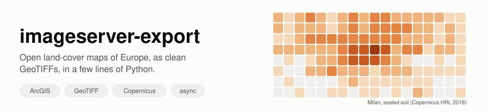
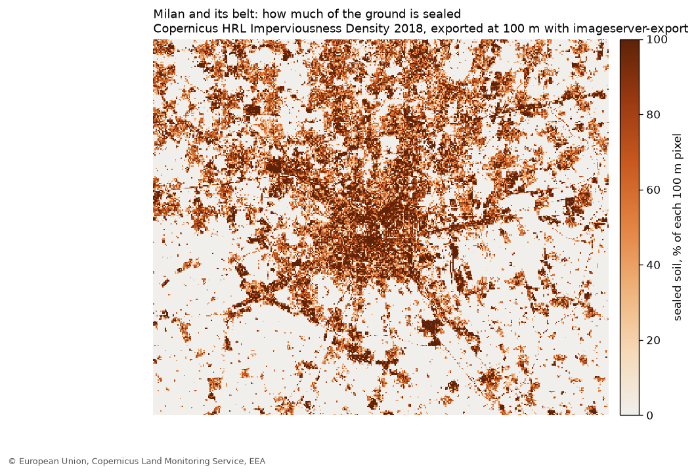
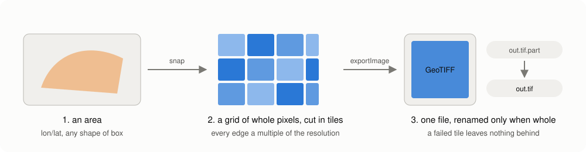
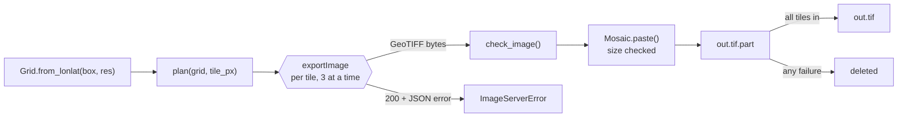
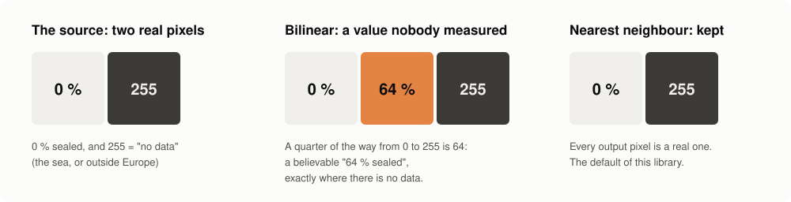

<p align="center">
  
</p>

<p align="center">
  <a href="https://github.com/agent-engineering-studio/imageserver-export/actions/workflows/ci.yml"></a>
  <a href="https://pypi.org/project/imageserver-export/"></a>
  <a href="https://agentengineering.it/imageserver-export/"></a>
  
  
  
  <a href="https://github.com/agent-engineering-studio/imageserver-export/blob/main/LICENSE"></a>
</p>

**imageserver-export** is a small, typed, async Python library that turns an
area of any **ArcGIS ImageServer** into one clean **GeoTIFF**. Its first use
is the open server of the European Environment Agency, which publishes the
**Copernicus Land Monitoring Service** maps of all of Europe, at 10 m:
how much of the ground is sealed by concrete and asphalt, how dense the
trees are, where the grassland, the water and the wetlands are. No account,
no key, no manual download.

```python
async with ImageServer(eea("HRL_ImperviousnessDensity_2018")) as server:
    await server.export(Grid.from_lonlat((8.95, 45.33, 9.45, 45.62), res=100), Path("milan.tif"))
```

Three dependencies: `httpx`, `numpy`, `rasterio`.

<p align="center">
  
</p>

---

## Contents

- [What is an ImageServer, in 30 seconds](#what-is-an-imageserver-in-30-seconds)
- [What this library does](#what-this-library-does)
- [Who is it for](#who-is-it-for)
- [Quick start](#quick-start)
- [The open maps of Europe](#the-open-maps-of-europe)
- [How it works](#how-it-works)
- [Why nearest neighbour](#why-nearest-neighbour)
- [Recipes](#recipes)
- [For AI agents: the MCP server](#for-ai-agents-the-mcp-server)
- [The traps we already fell into](#the-traps-we-already-fell-into)
- [API at a glance](#api-at-a-glance)
- [Data licence and credits](#data-licence-and-credits)
- [Contributing](#contributing)

## What is an ImageServer, in 30 seconds

Many public agencies publish their maps with **ArcGIS Server**. An
*ImageServer* is the part of it that serves rasters: grids of numbers, one
per pixel, like satellite-derived land cover. You give it a box, a size and
a coordinate system, and its `exportImage` operation sends back a picture of
that box.

That is enough to view a map, but not to *use* it. One request returns at
most a few thousand pixels a side, so Italy at 10 m takes thousands of them.
They have to line up exactly, or the pieces shift against each other. And
when something goes wrong, the server still answers "200 OK", with an error
message where the image should be.

This library does that part for you.

## What this library does

| | | |
|---|---|---|
| 🗺️ | **One area, one GeoTIFF** | Give it a longitude/latitude box and a resolution; get back one tiled, compressed GeoTIFF, georeferenced in the CRS you chose (LAEA Europe by default). |
| 📐 | **Pixels that line up** | The grid is snapped to whole pixels, and every request is a window of it: the server never resamples to fit, and tiles never shift. |
| 🧩 | **Big areas in pieces** | The area is cut into tiles the server accepts, fetched a few at a time, and pasted as they arrive. A whole country is just more tiles. |
| 🛟 | **A file or nothing** | The mosaic is written to `out.tif.part` and renamed only when every tile is in. A failure leaves nothing a later reader could mistake for a whole map. |
| 🚨 | **Errors that say why** | A JSON error sent with "200 OK", or a tile of the wrong size, stops the export with the server's own message. |
| 🧾 | **Where it came from** | The file carries its own provenance as GeoTIFF tags: service URL, interpolation, valid range, valid pixels, when and with which version. Add your own with `tags=`. |
| 🏷️ | **What the values mean** | `info()` describes the service (pixel type, size, extent, largest image); `attribute_table()` gives the label of every pixel value. |
| 🔌 | **Your HTTP, your rules** | Bring your own `httpx.AsyncClient`, or a `send` function: a shared retry policy, a cache or a rate limiter then sees every request. |

## Who is it for

- **Researchers and analysts** who need a Copernicus Land layer for a
  region, at the resolution of their own grid, in a script they can run again.
- **Risk and climate tools** that turn land cover into a factor per cell:
  sealed soil makes rain run off faster, tree cover feeds fires, wetlands
  change how floods spread.
- **Anyone with an ArcGIS ImageServer to read**, from the EEA or from a
  regional or national agency: the library is not tied to one server.

It was written for [Limen](https://github.com/agent-engineering-studio/limen),
an open early-warning platform for landslides, floods and wildfires in
Italy, which uses sealed soil to amplify the rain-driven flood trigger.

## Quick start

### 1. Install

```bash
pip install imageserver-export
```

### 2. Export an area

```python
import asyncio
from pathlib import Path

from imageserver_export import Grid, ImageServer, eea


async def main() -> None:
    async with ImageServer(eea("HRL_ImperviousnessDensity_2018")) as server:
        # Milan and its belt, at 100 m, in LAEA Europe (EPSG:3035).
        grid = Grid.from_lonlat((8.95, 45.33, 9.45, 45.62), res=100)
        result = await server.export(grid, Path("milan.tif"), valid_range=(0, 100))
        print(result.width, "x", result.height, "pixels,", f"{result.valid_fraction:.0%} valid")


asyncio.run(main())
```

`valid_range=(0, 100)` tells the library which values are real data: this
layer uses 254 for "unclassifiable" and 255 for "no data" (the sea, or
outside Europe), and both are kept in the file as they are.

### 3. Read it

The result is an ordinary GeoTIFF: open it in QGIS, or read it with
`rasterio`:

```python
import rasterio

with rasterio.open("milan.tif") as src:
    band = src.read(1)
    sealed = band[band <= 100]
    print(f"mean sealed soil: {sealed.mean():.1f} %")  # ~25 % around Milan
```

## The open maps of Europe

The EEA serves 26 Copernicus Land layers this way (`eea(name)` builds the
URL, `list_services(f"{EEA_URL}/{EEA_FOLDER}")` lists them). Among them:

| Layer (`eea(...)`) | What each pixel says | Native pixel |
|---|---|---|
| `HRL_ImperviousnessDensity_2018` | % of the ground sealed by buildings, roads, car parks | 10 m |
| `HRL_TreeCoverDensity_2018` | % of the ground under tree crowns | 10 m |
| `HRL_DominantLeafType2018` | broadleaved or coniferous forest | 10 m |
| `HRL_Grassland_2018` | grassland or not | 10 m |
| `HRL_WaterWetness_2018` | permanent water, temporary water, wet and dry ground | 10 m |
| `HRL_SmallWoodyFeatures_2018_005m` | hedges, tree rows, small groves | 5 m |
| `HRL_ImperviousnessChange_15_18` | how sealed soil changed, 2015 to 2018 | 20 m |

Each layer has a raster attribute table: `await server.attribute_table()`
returns, for the imperviousness layer, 102 rows such as
`{"Value": 1, "Class_name": "1% imperviousness value", "Area_km2": 222.19}`.

## How it works

<p align="center">
  
</p>



1. **The grid.** `Grid.from_lonlat` reprojects the box with densified edges
   (in an equal-area projection the sides of a geographic box curve, and its
   southern point is not a corner), then grows it outward to whole pixels.
2. **The tiles.** `plan()` covers the grid exactly once, edge tiles clamped
   to it. Every tile's box is a multiple of the resolution, so the server
   returns exactly the size asked for, with no resampling.
3. **The requests.** `export_params()` builds each `exportImage` query in the
   grid's own CRS, nearest neighbour by default. `check_image()` turns a JSON
   answer into an error with the server's message.
4. **The mosaic.** `Mosaic` writes a tiled, deflate-compressed GeoTIFF to
   `.part`, refuses a tile whose size differs from the one asked for, counts
   the valid pixels, writes the provenance tags, and renames the file only
   on success.

Every step is a plain function or class you can use alone; `ImageServer`
just puts them together.

## Why nearest neighbour

<p align="center">
  
</p>

Many land-cover layers keep their "no data" marker in the same band as the
data: 0 to 100 are percentages, 255 is "nothing here". Bilinear or cubic
resampling averages neighbours, so between a 0 % field and a 255 sea pixel
it can produce 64: a believable "64 % sealed", exactly where nothing was
measured. Nothing downstream can tell it from a real value.

So the default is `RSP_NearestNeighbor`: every output pixel is one the
server really has. Pass `interpolation="RSP_BilinearInterpolation"` only for
continuous layers with no sentinel values.

## Recipes

### Tree cover of a region, at 20 m

```python
grid = Grid.from_lonlat((15.3, 39.9, 16.9, 41.2), res=20)  # Basilicata
async with ImageServer(eea("HRL_TreeCoverDensity_2018")) as server:
    await server.export(
        grid,
        Path("basilicata_trees.tif"),
        valid_range=(0, 100),
        on_tile=lambda done, total: print(f"{done}/{total}"),
    )
```

### A whole country, without asking for the sea

```python
grid = Grid.from_lonlat((6.6, 35.5, 18.6, 47.1), res=100)  # Italy
async with ImageServer(eea("HRL_ImperviousnessDensity_2018")) as server:
    result = await server.export(
        grid, Path("italy.tif"), valid_range=(0, 100), skip_empty=True, resume=True
    )
print(result.skipped, "of", result.tiles, "tiles were only sea")
```

`skip_empty` asks first for one overview, 32 times coarser at the default
tile size, and sends no request for a tile with no data on it or next to it:
those are filled with "no data". Around Lampedusa it skipped 6 tiles out of
9, with the same pixels as the full export. A feature smaller than one
overview pixel and surrounded by sea can be missed, so it is off by default.

`resume` keeps every tile that arrived in `italy.tif.tiles/`: if the export
fails half way, running it again only asks for the missing ones.

### From 100 m pixels to 1 km cells

```python
from imageserver_export import aggregate

cells = aggregate(Path("italy.tif"), 10, valid_range=(0, 100))
cells.mean  # mean sealed soil per 1 km cell, NaN where no data
cells.valid_fraction  # share of each cell that held real data
cells.grid  # the 1 km grid, same corner as the raster
```

Sentinels stay out of the mean: a coastal cell half in the sea is the mean
of its land, with `valid_fraction` 0.5, not 128 % sealed. The raster is read
one strip of cells at a time.

### Your own grid, in your CRS

```python
# Snap to an existing 1 km grid in UTM 32N.
grid = Grid.snap((500_000, 4_500_000, 560_000, 4_560_000), res=1000, crs=32632)
```

### Label the classes

```python
async with ImageServer(eea("HRL_WaterWetness_2018")) as server:
    rows = await server.attribute_table()


# The label field is `Class_name` in some layers and `class_name` in others.
def label(row: dict) -> str | None:
    return next((v for k, v in row.items() if k.lower() == "class_name"), None)


labels = {row["Value"]: label(row) for row in rows}
# {0: 'Dry', 1: 'Permanent water', 2: 'Temporary water', 3: 'Permanent wet', ...}
```

### Any other ImageServer

```python
server = ImageServer("https://example.org/arcgis/rest/services/Elevation/ImageServer")
info = await server.info()  # pixel type, size, extent, largest image
await server.export(
    Grid.snap(box, res=info.pixel_size[0], crs=3857),
    Path("dem.tif"),
    pixel_type="F32",
    dtype="float32",
    nodata=None,
)
```

### Bring your own HTTP

```python
import httpx

async with httpx.AsyncClient(timeout=120) as client:  # your timeouts, proxies
    server = ImageServer(url, client, retries=5)


async def send(method: str, url: str, **kw) -> httpx.Response:
    return await my_retrying_client.request(method, url, **kw)  # your policy


server = ImageServer(url, send=send)  # every request goes through `send`
```

## For AI agents: the MCP server

```bash
pip install "imageserver-export[mcp]"
claude mcp add imageserver -- imageserver-mcp     # Claude Code
```

Or in Claude Desktop's `claude_desktop_config.json`:

```json
{ "mcpServers": { "imageserver": { "command": "imageserver-mcp" } } }
```

Then ask *"how much of the ground is sealed around Milan, and what is the
value at the Duomo?"*. The agent gets six tools:

| Tool | What it answers |
|---|---|
| `list_layers` | the layers of a folder (by default the EEA's 26 Copernicus Land layers) |
| `describe_layer` | pixel type, native resolution, CRS, extent, and what each value means |
| `attribute_table` | the raster attribute table, up to `limit` rows |
| `sample_point` | the value at a longitude/latitude, with its label |
| `area_summary` | mean, min, max, valid share and class counts (with labels) of a box |
| `export_area` | writes a box as a GeoTIFF into the output folder (the only tool that writes) |

A `service` is an EEA layer name or the URL of any ImageServer. **Every
number comes from the library, not from the model**: the agent finds the
data and explains it, the same rule as in Limen. Areas are capped
(4 million pixels for a summary, 25 million for an export) and a refusal
says which resolution would fit, so a single call cannot ask a server for a
continent at 10 m.

Over HTTP: `imageserver-mcp --transport streamable-http --port 8768` serves
`/mcp`, and `/health` for container healthchecks. Every option also reads
an environment variable (`IMAGESERVER_MCP_TRANSPORT`, `_HOST`, `_PORT`,
`_ALLOWED_HOSTS`, `_OUTPUT`).

Tried live: the Duomo of Milan is `100% imperviousness value`; the box of
Milan and its belt at 100 m is 27.9 % sealed on average, 59 % of it not
sealed at all.

## The traps we already fell into

- **"200 OK" is not success.** An ImageServer answers a bad request with
  HTTP 200 and a JSON error. Read as a TIFF, it is just "a corrupt file".
- **Four corners are not a box.** Reprojecting only the corners of Italy's
  longitude/latitude box to LAEA cut 6.8 km off the south: Lampedusa ended
  outside the raster, and 28 grid cells had no data.
- **Rounding a box cuts it.** Edges are grown to the next pixel, never
  rounded, or a strip of the area asked for goes missing.
- **A tile of the wrong size shifts everything.** It is refused, not pasted.
- **A half-written file looks whole.** Hence `.part` and the rename.
- **Field names are not consistent.** The label column of the attribute
  table is `Class_name` in the imperviousness layer and `class_name` in the
  water and wetness one: compare names case-insensitively.

## API at a glance

| | |
|---|---|
| `ImageServer(url, client=None, *, send=None, retries=3)` | the async client |
| `await server.info()` | `ServiceInfo`: pixel type, size, extent, largest image, CRS |
| `await server.attribute_table()` | the raster attribute table, as dicts |
| `await server.export(grid, dest, ..., skip_empty=False, resume=False, tags=None)` | `Export(path, tiles, width, height, valid_px, skipped, reused)` |
| `await list_services(folder_url)` | the ImageServer names of a folder |
| `Grid.from_lonlat(box, res, crs=3035)`, `Grid.snap(bounds, res, crs)` | the target grid |
| `plan(grid, tile_px=2048)`, `Tile.bounds(grid)` | the tiles |
| `export_params(...)`, `check_image(...)` | one request, pure |
| `Mosaic(path, grid, ...)` | the atomic GeoTIFF writer |
| `aggregate(path, factor, valid_range=None)` | `Aggregate(grid, mean, valid_fraction)`: coarse cells |
| `eea(name)`, `EEA_URL`, `EEA_FOLDER` | the European Environment Agency's server |

Full reference: [agentengineering.it/imageserver-export](https://agentengineering.it/imageserver-export/).

## Data licence and credits

The library is Apache-2.0. The data are not part of it: each server sets its
own terms. The Copernicus Land Monitoring Service layers the EEA serves are
free and open; credit them as *© European Union, Copernicus Land Monitoring
Service, European Environment Agency (EEA)* when you publish anything made
from them.

## Contributing

```bash
uv sync
make check                                   # ruff, mypy --strict, pytest (100 % coverage)
uv run --group docs python docs/make_images.py  # redraw the README images from live data
uv run --group docs mkdocs serve             # the documentation site, locally
```

Ideas: a command-line `imageserver-export` entry point; a `bbox` given in
any CRS; multi-band exports.

## License

[Apache-2.0](./LICENSE).
